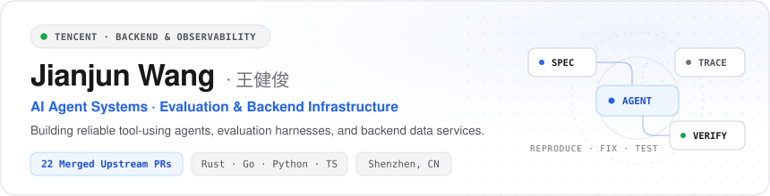
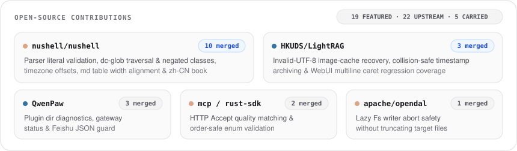
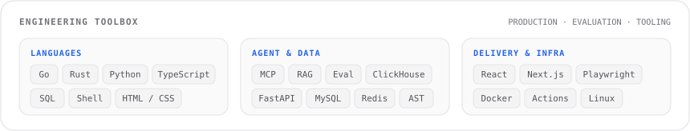

  <a href="https://wangjianjun.xyz">
    <picture>
      <source media="(prefers-color-scheme: dark)" srcset="assets/profile-hero-dark.svg" />
      <source media="(prefers-color-scheme: light)" srcset="assets/profile-hero-light.svg" />
      
    </picture>
  </a>

  <a href="https://wangjianjun.xyz"><strong>Portfolio</strong></a>
  &nbsp;&nbsp;·&nbsp;&nbsp;
  <a href="https://github.com/pulls?q=is%3Apr+is%3Amerged+author%3Apassionworkeer+-user%3Apassionworkeer"><strong>Merged PRs</strong></a>
  &nbsp;&nbsp;·&nbsp;&nbsp;
  <a href="https://github.com/passionworkeer?tab=repositories"><strong>Repositories</strong></a>
  &nbsp;&nbsp;·&nbsp;&nbsp;
  <a href="https://passionworkeer.github.io/passionworkeer/"><strong>Writing</strong></a>

 

  <a href="https://github.com/pulls?q=is%3Apr+is%3Amerged+author%3Apassionworkeer+-user%3Apassionworkeer">
    <picture>
      <source media="(prefers-color-scheme: dark)" srcset="assets/oss-bento-dark.svg" />
      <source media="(prefers-color-scheme: light)" srcset="assets/oss-bento-light.svg" />
      
    </picture>
  </a>

 

### Experience

| Period | Organization | Role & Focus |
| :--- | :--- | :--- |
| `Oct 2026 – Present` |  | **Backend Development Intern** · Monitoring ingestion, analytical queries, usage metering, and data consistency |
| `Aug – Oct 2026` |  | **Agent Development Intern** · Design-agent evaluation, structured Figma editing, MCP integration, and failure diagnosis |
| `Mar – Sep 2026` | **RepoMind** | **Tencent × SZTU Industry Project** · Coding-agent trace analysis, evaluation harnesses, code retrieval, and incremental indexing |
| `Mar – Jul 2026` |  | **AI Application Engineer** · AIGC visual workflows, Photoshop UXP plugins, and enterprise agent integrations |

 

### Selected Projects

| Project | Summary |
| :--- | :--- |
| **[LaTeX Resume Skill](https://github.com/passionworkeer/latex-resume-skill)** | Evidence-based resume authoring with 20 LaTeX templates, a visual editor with real PDF previews, and automated content/layout verification |
| **[yt · Shared Memory Bus](https://github.com/passionworkeer/obsidian-shared-memory-bus)** | Local-first MCP runtime sharing structured memory, provenance, and hybrid retrieval across AI coding tools |
| **[Attrax / CompliPilot](https://github.com/passionworkeer/attrax)** | Product-image compliance research with source-linked regulatory findings and exportable audit evidence |

 

  <picture>
    <source media="(prefers-color-scheme: dark)" srcset="assets/stack-bento-dark.svg" />
    <source media="(prefers-color-scheme: light)" srcset="assets/stack-bento-light.svg" />
    
  </picture>

